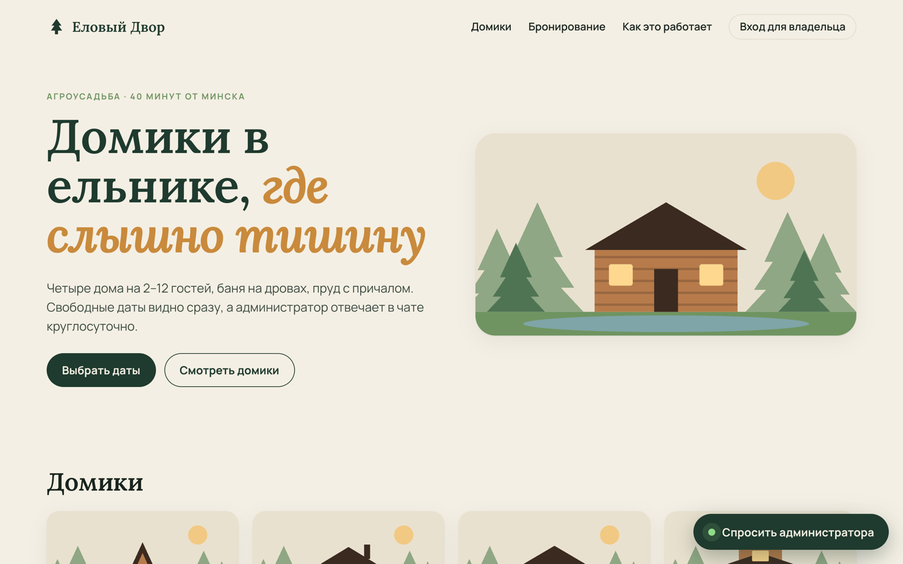
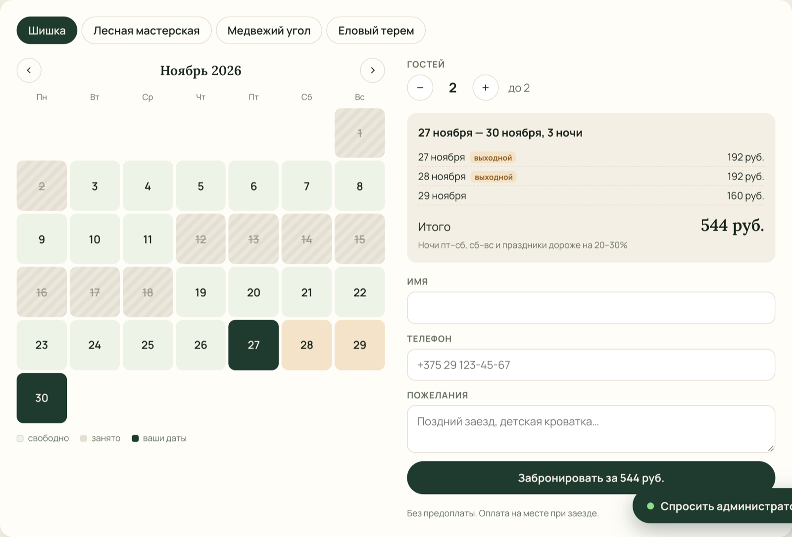
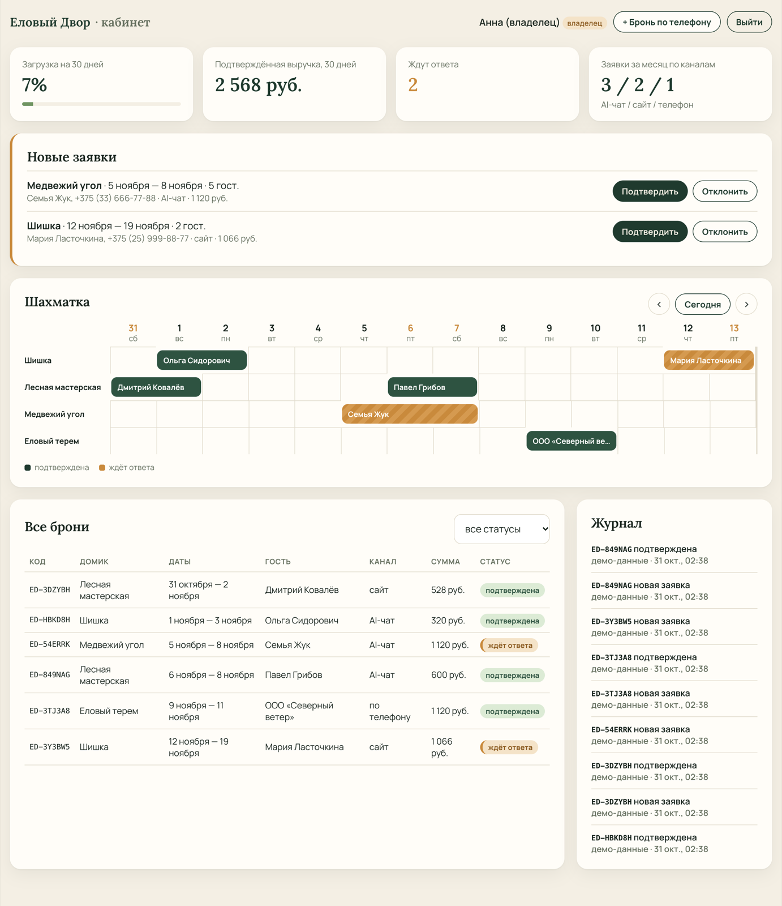
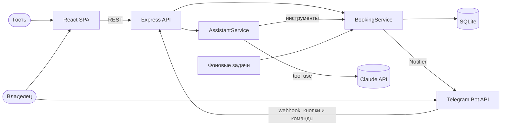

# Еловый Двор: система бронирования с AI-администратором

Fullstack-система для загородной усадьбы (бизнес вымышленный). Гость выбирает домик на сайте или пишет AI-администратору в чат обычными словами. Владелец получает заявку в Telegram и подтверждает её одной кнопкой. Рутину берут на себя фоновые задачи: просроченные заявки истекают сами, накануне заезда приходит напоминание, каждое утро — сводка.




| Бронирование с живым расчётом цены | Кабинет владельца |
|---|---|
|  |  |

## Что умеет

**Для гостя**
- Календарь занятости по каждому домику; выбрать занятую ночь нельзя, а заехать в день выезда предыдущих гостей можно.
- Цена считается сразу и по ночам: будни, выходные (+20%), государственные праздники РБ (+30%), скидка 10% от 7 ночей.
- AI-администратор в чате понимает «на эти выходные вдвоём, можно с собакой», сам проверяет свободные даты, считает стоимость и оформляет заявку.

**Для владельца**
- Заявка приходит в Telegram с кнопками «Подтвердить / Отклонить»; после нажатия сообщение обновляется со статусом.
- Команды бота `/today` (сводка дня) и `/pending` (заявки без ответа).
- Кабинет: шахматка занятости, KPI (загрузка, выручка, заявки по каналам), журнал действий, ручное добавление брони по телефону.
- Две роли: владелец видит выручку и может отменять подтверждённые брони, менеджер только обрабатывает заявки.

**Автоматизация** (`apps/api/src/automation/jobs.ts`)
| Задача | Когда | Что делает |
|---|---|---|
| Истечение заявок | каждую минуту | заявка без ответа 24 часа получает статус «истекла», даты освобождаются, владелец получает уведомление |
| Напоминание о заезде | каждую минуту | для подтверждённых броней на завтра — одно сообщение «подготовьте домики» |
| Утренний дайджест | раз в день после 9:00 | заезды, выезды, заявки без ответа, загрузка и выручка на неделю |
| Очистка | каждую минуту | удаляет сессии чата старше суток |

Задачи идемпотентны: повторный запуск не шлёт дубли (таблица `job_runs`, поле `reminder_sent_at`).

## Архитектура



- **`BookingService`** — вся бизнес-логика: проверка дат, расчёт цены, проверка пересечений, переходы статусов. Сайт, AI-ассистент, Telegram и админка ходят через него, поэтому правила одни для всех каналов.
- **`Notifier`** — интерфейс канала уведомлений. В продакшене это Telegram, в тестах — запись в массив. Уведомление отправляется после коммита транзакции, так что сбой Telegram не отменяет бронь.
- **Двойное бронирование** исключено: проверка пересечений и вставка выполняются в одной `BEGIN IMMEDIATE`-транзакции, а переход статуса — условным `UPDATE … WHERE status = ?`.

### Как устроен AI-администратор

`apps/api/src/assistant/` — цикл tool use на [Claude API](https://platform.claude.com/docs) через официальный SDK `@anthropic-ai/sdk`.

1. Сообщение гостя добавляется к истории диалога, которая **хранится на сервере**. Клиент присылает только `sessionId` и текст, поэтому подделать ответы модели или результаты инструментов нельзя.
2. Модели доступны четыре инструмента: `list_cabins`, `check_availability`, `get_quote`, `create_booking_request`. Схемы объявлены со `strict: true`, но вход всё равно повторно проверяется через zod.
3. Инструменты вызывают тот же `BookingService`. Бизнес-ошибка («минимум 2 ночи», «даты заняты») возвращается модели как `is_error`, и она объясняет её гостю своими словами.
4. Ограничения: не больше 6 запросов к модели на одно сообщение, не больше 2 заявок на диалог, лимит длины истории, rate limit на IP.
5. Ассистент не подтверждает брони сам: заявка всегда уходит владельцу (human-in-the-loop).

Цены и наличие модель берёт только из инструментов; так сказано в системном промпте, и ответы проверены тестами со сценарием ответов модели.

## Безопасность

- Сессия админки в JWT, который лежит в `httpOnly`, `SameSite=Strict`, `Secure` cookie (в продакшене). Алгоритм зафиксирован на `HS256`, а пользователь перечитывается из БД на каждый запрос.
- Пароли хешируются bcrypt. При входе с несуществующим email всё равно выполняется сравнение хеша, чтобы по времени ответа нельзя было подобрать адреса.
- CSRF: cookie SameSite=Strict плюс проверка `Origin` у всех запросов, которые меняют данные.
- Rate limit на вход (10 попыток за 15 минут), заявки (5 в час) и чат (30 сообщений за 10 минут); поле-ловушка против ботов.
- Webhook Telegram проверяет секретный заголовок через `timingSafeEqual` и принимает нажатия только из чата владельца.
- Данные гостя экранируются перед отправкой в Telegram (`parse_mode=HTML`).
- Валидация всех входов через zod. Ответ на публичную заявку не содержит персональных данных. helmet с CSP, ограничение размера тела запроса.
- Конфигурация проверяется при старте: сервер не запустится с `JWT_SECRET` короче 32 символов.

## Стек

**Backend:** Node.js, TypeScript, Express 5, SQLite (better-sqlite3), zod, JWT, bcrypt, Claude API, Telegram Bot API
**Frontend:** React 19, TypeScript, Vite, React Router, чистый CSS без UI-библиотек
**Инфраструктура:** Vitest и Supertest (47 тестов), Docker, GitHub Actions

## Запуск

```bash
npm install
cp apps/api/.env.example apps/api/.env   # впишите JWT_SECRET: openssl rand -hex 32
npm run seed                             # домики, демо-брони и пользователи
npm run dev                              # API :4000, сайт :5173
```

Вход в кабинет: `owner@elovy-dvor.test` / `demo-owner-2026` (владелец) или `manager@elovy-dvor.test` / `demo-manager-2026` (менеджер).

AI-чат включается ключом `ANTHROPIC_API_KEY` в `.env`. Без ключа всё остальное работает, а чат отвечает, что не настроен.

### Telegram

1. Создайте бота у [@BotFather](https://t.me/BotFather) и узнайте ID своего чата (например, через [@userinfobot](https://t.me/userinfobot)).
2. Заполните `TELEGRAM_BOT_TOKEN`, `TELEGRAM_CHAT_ID`, `TELEGRAM_WEBHOOK_SECRET` в `.env`.
3. После деплоя на публичный https-адрес выполните `npm run telegram:webhook -w @elovy-dvor/api -- https://ваш-домен`.

Уведомления о новых заявках работают и без webhook; webhook нужен для кнопок и команд.

### Docker

```bash
docker compose up --build    # сайт и API на http://localhost:4000
```

Один контейнер отдаёт и API, и собранный фронтенд, поэтому CORS не нужен. База лежит в volume `data`.

### Проверки

```bash
npm test          # 47 тестов API
npm run typecheck
npm run build
```

Тесты покрывают расчёт цен и праздников, пересечение дат, переходы статусов, авторизацию и роли, rate limit, CSRF по Origin, webhook Telegram (секрет, чужой чат, повторное нажатие), экранирование HTML, фоновые задачи с подменой времени и цикл AI-ассистента с подменой Claude API.

## Структура

```
apps/
  api/
    src/
      domain/        даты, цены, телефоны, типы и переходы статусов
      services/      BookingService, статистика, интерфейс уведомлений
      assistant/     AI-администратор: инструменты и цикл tool use
      telegram/      клиент Bot API, уведомления, webhook
      automation/    фоновые задачи
      http/          авторизация, публичные и админские маршруты
      app.ts         сборка Express-приложения (используется и в тестах)
    test/
    scripts/         демо-данные, регистрация webhook
  web/
    src/
      components/    календарь, панель бронирования, чат, шахматка
      pages/         сайт и кабинет
```

## Об авторе

Григорий Лазовский, fullstack JS-разработчик из Минска. Telegram: [@devgri](https://t.me/devgri).

Проект создан с использованием Claude Code, AI-ассистента для программирования; это отмечено в истории коммитов.
